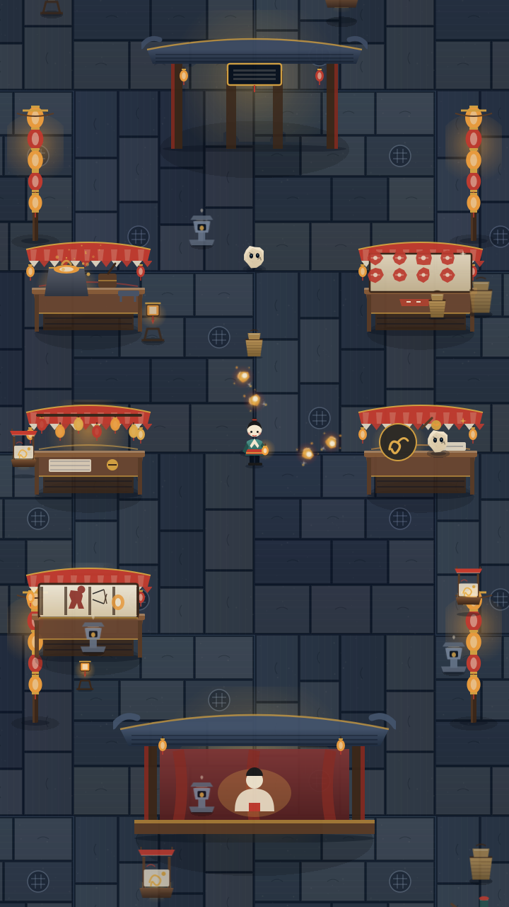
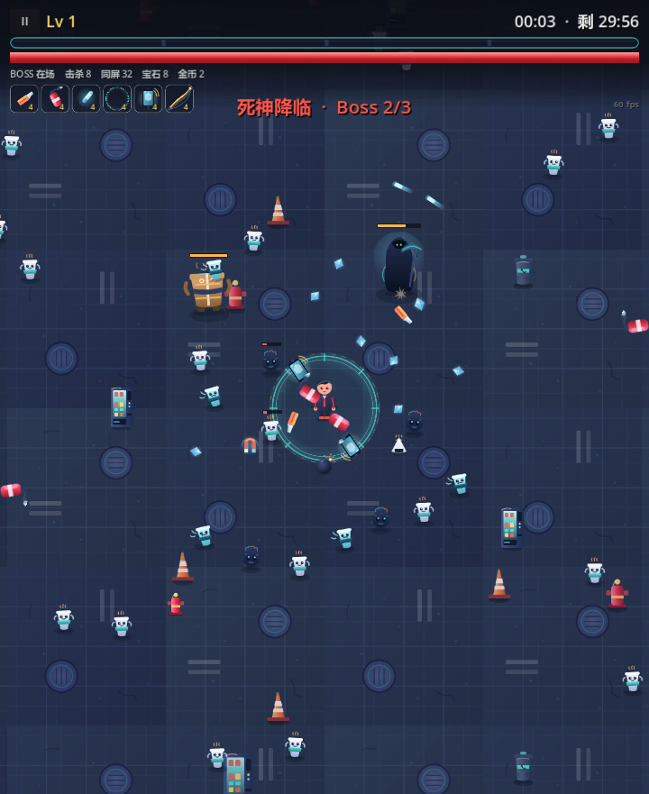
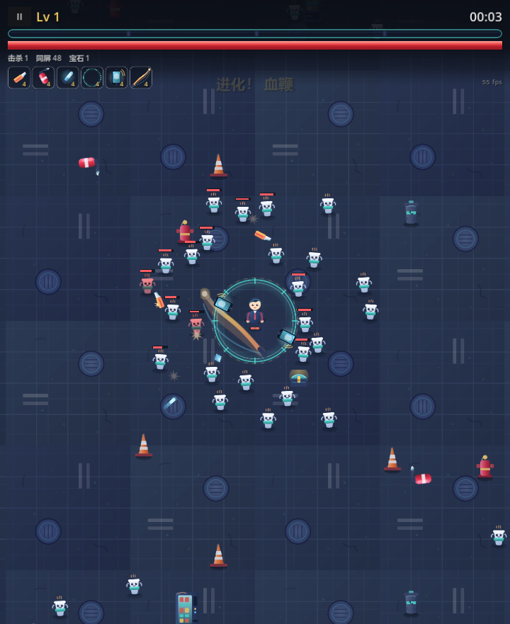
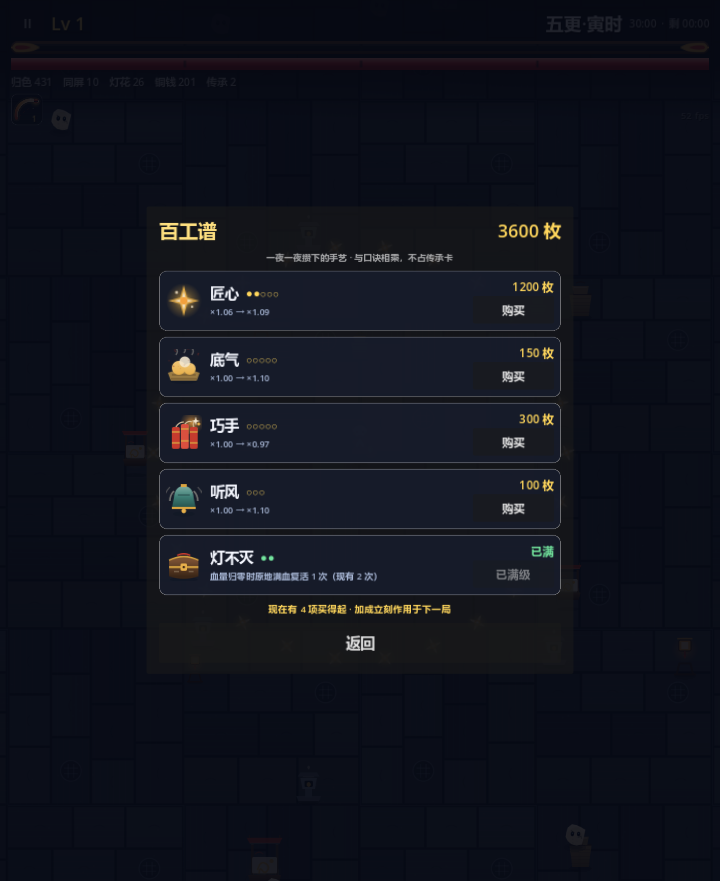

# FirstXiXueGui · 守艺人·百工夜行

民俗手艺题材的竖屏生存肉鸽（survivor-like）· Godot 4.7.2 · **v1.0**

单摇杆移动、自动攻击、30 分钟一局、升级三选一、局外传承。720×1280 竖屏，60 FPS，已导出 Windows x64 与 Android arm64 可运行包。

> **这是一个 AI 协作完成的学习项目。** 人负责方向、取舍、试玩与门禁判断；AI 负责读代码、写实现、写断言、跑回归。详见 [AI_USAGE.md](AI_USAGE.md)。
> 仅供学习查看，**不是可发行产品**：无版号、未做真人试玩、文化合规未签字。
> 合规签字前对外一律称「民俗手艺题材」，不使用「非遗」二字。

| 主菜单 / 夜市置景 | 战斗与 Boss |
|---|---|
|  |  |

| 升级卡面与清屏 | 局外商店「百工谱」 |
|---|---|
|  |  |

---

## 一、下载即玩（封装启动包）

发布包托管在本仓库的 **Releases** 页（Windows 单文件 exe 110 MB，超过 GitHub 普通仓库 100 MB 单文件上限，故不进源码树）：

> **下载**：<https://github.com/LjxMax2003/FirstXiXueGui/releases/tag/v1.0>

| 平台 | 附件 | 说明 |
|---|---|---|
| Windows 10/11 x64 | `FirstXiXueGui.exe` | 单文件，PCK 内嵌，双击即玩（110 MB） |
| Windows 压缩包 | `FirstXiXueGui-Windows-x64-v1.0.zip` | 同一 exe 的 zip 版（42 MB） |
| Android 7.0+ arm64 | `FirstXiXueGui-1.0.apk` | 已签名，可直接侧载（31 MB） |

`release/` 目录进仓库的只有说明与校验值；二进制由本地导出后上传为 Release 附件，导出命令见 [`release/README.md`](release/README.md)。

- Windows 若提示缺 `MSVCP140.dll`，装 [VC++ 2015-2022 运行库](https://aka.ms/vs/17/release/vc_redist.x64.exe)。
- 操作：桌面 WASD / 方向键移动、鼠标点界面（也支持鼠标拖拽模拟摇杆）；手机任意处按住拖动出虚拟摇杆。
- 存档：Windows `%APPDATA%\Godot\app_userdata\FirstXiXueGui\`，Android 应用私有目录。
- SHA-256 校验值见 [`release/README.md`](release/README.md)。

> 签名口令未入库（`export_presets.cfg` 的 `keystore/*` 已清空），重新导出请用你自己的密钥库。

---

## 二、从源码运行（原游戏工程）

```
GameDemo/first-xi-xue-gui/          # Godot 4.7.2 工程根
├── project.godot                   # 720×1280 竖屏、Mobile 渲染、锁 60fps
├── scenes/                         # 11 个场景：Game / MainMenu / Player / Enemy / Gem / weapons / ui
├── scripts/                        # 43 个 GDScript（全静态类型）
├── assets/
│   ├── art_shouyiren/              # 140 张 SVG：角色 / 敌人 / 武器 / 摊位 / UI / FX
│   ├── shaders/                    # 16 个 canvas_item shader（含 8 个技能向）
│   └── audio/                      # 2 首 BGM + 6 个 SFX（WAV）
├── tools/                          # 37 个测试/验收场景（SmokeTest / 平衡审计 / 帧率探针…）
└── export_presets.cfg              # Windows Desktop + Android 两个导出预设
```

```bash
# 1. 装 Godot 4.7.2 stable（本仓库不含引擎二进制）
#    https://godotengine.org/download/archive/4.7.2-stable/
# 2. 编辑器打开 GameDemo/first-xi-xue-gui/project.godot，F5 运行
# 3. 或直接命令行跑
godot --path GameDemo/first-xi-xue-gui
```

**回归门禁**（改动后必跑）：

```bash
godot --headless --path GameDemo/first-xi-xue-gui res://tools/SmokeTest.tscn   # 312 断言，约 60s
```

另有一批带画面的验收场景（**不能加 `--headless`**）：`FxInGame` / `V6Fx` / `MenuRipple` / `HudFxGap` / `V5InGame` / `P5Perf`，`godot --path … res://tools/<名字>.tscn` 直接运行。

---

## 三、v1.0 有什么

### 玩法

| 模块 | 内容 |
|---|---|
| 单局 | 30 分钟，夜晚五更推进；倒计时结束「撑到天亮了」结算 |
| 武器 | 9 把，各 8 级。傩面·师刀 / 花灯 / 荧光棒 / 手机 / 美工刀 / 灭火器 / 铜锣 / 墨斗 / 木板年画 |
| 进化 | 武器满级 + 对应被动点满 → 开脸进化，共 6 条配方 |
| 被动 | 7 条，走 `Stats` 单向管线（被动 → 属性 → 武器），不互相叠加污染 |
| 升级 | 每级三选一卡牌；卡面文案由数值反推生成，**显示的伤害等于实际落地的伤害** |
| 敌人 | 3 种杂兵 × 3 帧走路 + 结壳变体、2 种精英、Boss 三现（随阶段叠特效层） |
| 局外 | 铜钱 → 百工谱（5 项永久成长）、5 位匠人角色、33 条图鉴、设置面板、开场三页引导 |
| 音频 | 2 首 BGM + 6 个 SFX，懒加载 + 复用播放器 |
| 反馈 | 16 个自研 shader 统一经 `ShaderFX.gd` 调度：受击闪、噪声溶解、法阵、红边、扫光、弧光、尾迹、领域… |

### 技术要点

- **单向数据管线**：被动 → `Stats` → 武器。属性换算只有 `Stats.value_at` 一个出口，局外加成走第二乘区 `effective_at`。
- **合批红线**：小怪同屏 50~200 只，绝不挂独立 ShaderMaterial，换色只用 `modulate`；shader 只给精英/Boss/玩家/掉落。
- **性能基线**：60fps 锁定；`P5Perf` 400 只同屏下 P95 ≤ 16.6ms。
- **数值单一真值**：数值只存在于 `WeaponDB` / `EvolutionDB` / `UpgradeDB` / `Stats` 四张表，`tools/BalanceAudit.tscn` 与基线 JSON 比对守门。

---

## 四、怎么做出来的

### 4.1 工具：国内软件为主，全部对话式驱动

| 类别 | 用了什么 | 承担的部分 |
|---|---|---|
| 对话式 AI 编程 | **WorkBuddy**（腾讯） | v6/v7 内容纵深、缺陷定位与修复、自动化门禁编写与回归、文档对账 |
| 对话式 AI 编程 | **Qoder**（阿里） | 前期题材策划、美术需求拆解、P1~P5 换皮实现与验收 |
| AI 智能体 / 专家角色 | WorkBuddy 内置专家与技能包（Godot 场景、Shader、2D 像素对齐、无头测试等） | 按任务加载对应领域规则与工作流，而不是每次从零问 |
| 引擎 | **Godot Engine 4.7.2**（开源） | 运行时、渲染、导出 |

没有一个环节是"一句话生成整个游戏"。真实做法是**人在回路的多轮对话 + MCP 与智能体作为执行手**。

### 4.2 对话式 + MCP + 已有智能体：怎么落地的

```
人给方向（说清要什么 / 不要什么）
   ↓
AI 通过 MCP 直连工程与引擎：读真实代码、查节点与场景树、跑无头门禁、收运行日志
   ↓
AI 调起已有的专家角色与技能包（Godot 专家、Shader 技能、无头测试技能…）
   ↓
AI 产出改动 + 可执行断言 → 跑回归 → 红灯定位是代码错还是测试错 → 修 → 绿灯
   ↓
人看截图 / 试玩手感 → 决定保留或推翻 → 写决策记录
```

- **对话式**：需求、取舍、纠错全在会话里推进。AI 被要求「先读代码再下结论」——文档说 A、代码是 B 时以代码为准，避免按记忆瞎改。
- **MCP（Model Context Protocol）**：把引擎能力以工具形式接给 AI（场景树查询、脚本读写、无头运行、日志回传），AI 不必猜工程长什么样，能直接跑起来看结果。
- **已有智能体 / 专家 / 技能包**：不重复造轮子。Godot 4 的场景组织、全静态类型写法、`ShaderFX` 统一入口、竖屏像素对齐、`--headless` 测试套件，都直接加载现成规范执行。
- **门禁化**：每条修完的缺陷都附断言并进 `SmokeTest`（312 条）等 6 套门禁，防止改回去。视觉问题必须截图——单看代码「三层、宽度递增、清理」全对，实际画面上 Boss 被光吃掉，本项目两次翻车都是截图发现的。

### 4.3 AI 参与的边界

- 人决定做什么/不做什么、跑门禁、判断手感、决定是否发布。
- **文化合规签字权在人**，AI 只产核对清单，不能代替签字。
- 模型名与版本随工具服务端切换，仓库内没有逐次调用快照，因此 [AI_USAGE.md](AI_USAGE.md) 只写工具、不编模型版本。

---

## 五、仓库里有什么 / 没有什么

**提交**：游戏本体工程（`GameDemo/`）、发布说明与校验值（`release/README.md`）、本说明、AI 声明、许可。

**不提交**（本地工作区的过程材料，已写入 `.gitignore`）：

| 目录 | 内容 |
|---|---|
| `docs/` | 策划案、题材选型、数值模型（v3~v7 各版 `*.py` 与基线 JSON）、设计文档、合规核对清单 |
| `assets/craftkeepers/` | 美术源库、SVG 生成器脚本、光栅化校核工程、拼版预览 |
| `reports/` | 各阶段执行报告与验收日志 |
| `tools/` | Godot 引擎二进制、美术构建中间产物 |

成品美术已拷入工程 `assets/art_shouyiren/`，运行与导出不依赖上述目录。

---

## 六、已知边界

| 项 | 状态 |
|---|---|
| 文化合规签字 | **未签**。签字前对外只能说「民俗手艺题材」 |
| 真人试玩 / 手感调优 | 未做。数值结论来自模型与自动化门禁，**不等于好玩** |
| iOS | 未构建（需 macOS + Xcode + 对应导出模板） |
| Android 覆盖 | 仅本人设备验证 |
| 版号 / 商标 / 商店素材 | 无，不可上架 |
| 第三方素材 | 零。SVG 全部程序化/AI 辅助生成，无网络下载、无第三方字体、无他人照片 |

---

## 七、许可

[MIT](LICENSE)。工程内不含任何第三方素材、真实照片、传承人作品。
「守艺人」为通用词且未做商标检索，仓库标题使用工程名 `FirstXiXueGui`。
