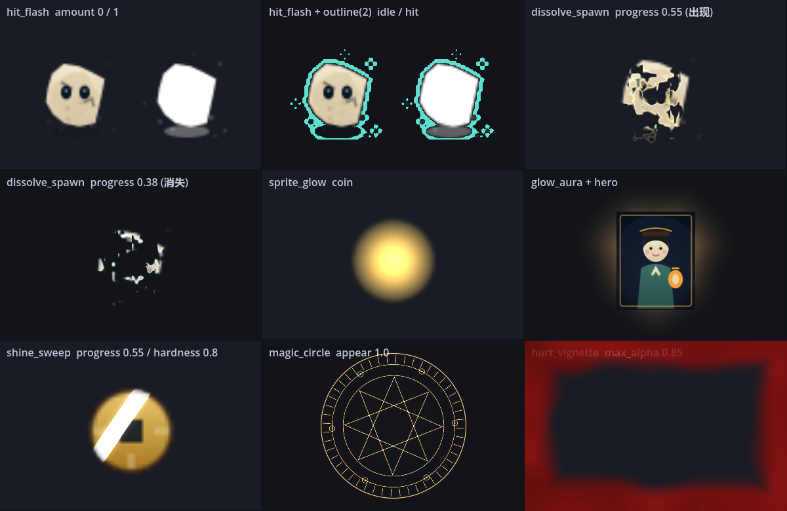
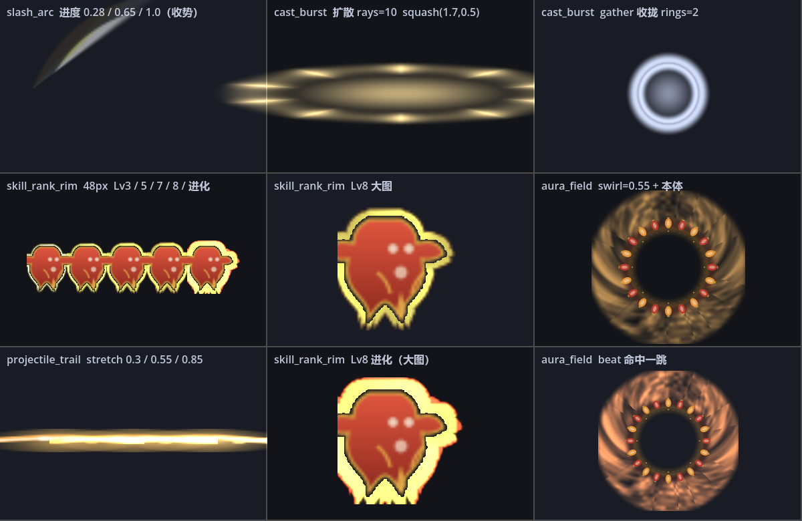

# 视觉特效包（Godot 4 · canvas_item）

从 [godotshaders.com 最新条目](https://godotshaders.com/shader/?orderby=date\&order=DESC) 里挑出**能吃进本工程**的 12 个效果 —— 战斗反馈 7 个、技能表现 5 个 —— 按 720×1280 竖屏、48px 敌人、mobile 渲染后端重新写了一遍，并在独立工程里实跑渲图确认（不是抄下来没跑过就交付）。

选型只认三条线：**2D 可用**、**不碰 SCREEN_TEXTURE / DEPTH_TEXTURE**、**一个参数能被脚本 tween 驱动**。三条都过才收。

---

## 1. 交付清单

### 1.1 战斗反馈（7 个）

| 文件                                                               | 作用                                             |
| ---------------------------------------------------------------- | ---------------------------------------------- |
| `GameDemo/first-xi-xue-gui/assets/shaders/fx/hit_flash.gdshader` | 受击闪光，自带可选描边（替代 outline.gdshader 与 modulate 换色） |
| `…/fx/dissolve_spawn.gdshader`                                   | 出现 / 消失，噪声溶解 + 发光边，一个 `progress` 双向用           |
| `…/fx/sprite_glow.gdshader`                                      | 本体脉冲发光（加法混合，光被裁在贴图轮廓内）                         |
| `…/fx/glow_aura.gdshader`                                        | 程序化光晕，零贴图，尺寸随意拉                                |
| `…/fx/shine_sweep.gdshader`                                      | 道具 / 卡片扫光                                      |
| `…/fx/hurt_vignette.gdshader`                                    | 全屏受伤红边（噪声内边界，竖屏已做像素归一化）                        |
| `…/fx/magic_circle.gdshader`                                     | 程序化法阵：技能预警 / 召唤 / 传送                           |



（左起：受击闪 / 受击闪+描边 / 溶解出现｜溶解消失 / 本体发光 / 光晕｜扫光 / 法阵 / 受伤红边）

### 1.2 技能表现（5 个，`assets/shaders/fx/skill/`）

| 文件                                  | 作用                                | 类型       |
| ----------------------------------- | --------------------------------- | -------- |
| `…/skill/slash_arc.gdshader`        | 挥砍弧光 —— **遮罩式**，挂在现有弧光贴图上逐帧扫出     | 发动       |
| `…/skill/cast_burst.gdshader`       | 发动冲击环 —— 扩散 / 收拢，可压成椭圆贴矩形判定       | 发动       |
| `…/skill/projectile_trail.gdshader` | 弹道辉光尾 —— 在贴图自身 UV 里拖尾，跟着 sprite 转 | 发动       |
| `…/skill/skill_rank_rim.gdshader`   | 技能等级外框 —— 三档颜色 / 三档厚度 / 流动，余光可读   | 升级区分（常驻） |
| `…/skill/aura_field.gdshader`       | 领域能量场 —— 环流噪声，命中时 `beat()` 一跳     | 持续表现（常驻） |



（上排：弧光三档进度｜下排：冲击环椭圆扩散 / 收拢｜等级外框 48px 五档 + 大图｜能量场 + 本体｜弹道尾三档）

其余交付：

| 文件                                                     | 作用                                     |
| ------------------------------------------------------ | -------------------------------------- |
| `…/fx/fx_manifest.json`                                | 机器可读清单：12 条的参数、默认值、驱动方式、互斥关系、坑点、来源 URL |
| `GameDemo/first-xi-xue-gui/scripts/ShaderFX.gd`        | 统一调用层：材质接管 / 还原 / 缓存 / tween 冲突处理      |
| `GameDemo/first-xi-xue-gui/tools/FxSheet.tscn(.gd)`    | 自检工具，一键重渲 `fx-preview.png`             |
| `GameDemo/first-xi-xue-gui/tools/SkillSheet.tscn(.gd)` | 自检工具，一键重渲 `skill-preview.png`（技能向）     |

---

## 2. 最短接入路径

```gdscript
# 受击（精英、Boss、玩家；小怪见第 4 节）
ShaderFX.flash(art, ShaderFX.HIT_COLOR, 0.12)

# 出场 / 死亡
ShaderFX.spawn_in(art, 0.35)
ShaderFX.dissolve_out(art, 0.45)

# 道具
ShaderFX.sweep(icon, 0.5)                       # 扫一次光
ShaderFX.set_item_glow(icon, true)              # 常亮脉冲

# 技能
var c := ShaderFX.spawn_circle(player, 180.0)   # 返回 ColorRect，自己 queue_free()
ShaderFX.add_aura(node, 120.0)                  # 返回光晕节点，挂在背后

# 技能 · 发动
ShaderFX.slash(arc, 0.12)                                        # 弧光扫出（遮罩式）
ShaderFX.burst(self, Vector2(280, 90), Color(1,0.86,0.55), Vector2(1.7, 0.5), 10)  # 冲击环，椭圆贴矩形判定
ShaderFX.set_trail(bullet, 0)                                    # 弹道辉光尾

# 技能 · 升级区分
ShaderFX.set_rank(slot_icon, WeaponManager.weapon_level(id), WeaponManager.is_evolved(id))

# 技能 · 持续表现
var f := ShaderFX.field(ring_node, 260.0)       # 领域能量场
ShaderFX.field_beat(f)                          # 命中一跳（接 GarlicRing.beat()）
ShaderFX.field_resize(f, 320.0)                 # 升级加范围

# 玩家受伤
ShaderFX.hurt(hud.hurt, 0.8, 0.5)
```

---

## 3. 具体接到哪一行

> 本节是**接入设计稿**。实际落地后的位置、参数与取舍一律以 **§8（战斗反馈 7 个）** 与 **§9.5（技能向 5 个）** 为准（有出入时以那两节为准，因为只有它们是跑过截图验证的；差异与原因见 §8.1 / §9.6）。

### 3.1 敌人受击 —— `scripts/Enemy.gd: take_damage()`

现在是 `art.modulate = HIT_COLOR`（`_hit_left` 计时衰减）。modulate 是**乘法**，暗色贴图提不亮，而且会连同描边一起染色。

```gdscript
# 精英 / Boss 走 shader（同屏数量 < 10，合批损失可以忽略）
if is_elite or is_boss:
	ShaderFX.flash(art, ShaderFX.HIT_COLOR, 0.10)
else:
	art.modulate = HIT_COLOR      # 小怪保持现状，见第 4 节
```

快速怪描边不用再单独挂 `outline.gdshader`：`ShaderFX.flash()` 检测到原材质是 outline 时会自动把 `outline_color` / `outline_width` 搬过去，视觉零跳变。

### 3.2 敌人出场 / 死亡 —— `Enemy.setup()` / `Enemy._die()`

```gdscript
# setup() 末尾
if is_elite or is_boss:
	ShaderFX.spawn_in(art, 0.40)

# _die() 里
if is_elite or is_boss:
	ShaderFX.dissolve_out(art, 0.45, false)   # restore=false：反正马上要 hide() 回收
```

`restore=false` 是刻意的：池化敌人的 `setup()` 每次都会重设 `art.material`，所以不必在回收前还原。**如果哪天改成不重设材质，这里必须改成 `true`**，否则复用的敌人会带着 `progress = 0` 出来——也就是"看不见的怪打你"。

### 3.3 玩家受伤红边 —— `scenes/ui/HUD.tscn` 的 `Hurt` 节点

现在是一个整屏纯红 ColorRect，`HUD.gd:162` 用 `hurt.color.a = HURT_ALPHA * _player.hit_flash` 驱动。**成本相同，换成红边更好看**：

1. 给 `Hurt` 节点新建 ShaderMaterial，shader 选 `hurt_vignette.gdshader`；
2. `screen_size` 保持 `(720, 1280)`——和 `project.godot` 的 viewport 一致，竖屏四边厚度才均匀；
3. `HUD.gd` 第 162 行改成：

```gdscript
(hurt.material as ShaderMaterial).set_shader_parameter("max_alpha", HURT_ALPHA * _player.hit_flash)
```

整屏均匀泛红会读成"屏幕坏了"，边缘侵蚀才读成"我快不行了"——这是换它的唯一理由。

### 3.4 道具 / 掉落物 —— `Gem.gd`、`PropField.gd`

`Gem` 是 `Sprite2D`，直接 `ShaderFX.set_item_glow(self, true, Color(1.0, 0.78, 0.32))`。注意 `blend_add` 会盖掉描边，两者别同时开。

铜钱、宝箱这类"要玩家注意到"的，用 `ShaderFX.sweep(icon, 0.5)` 扫一次就停，别设 `auto_speed`——常亮扫光在满屏掉落时会变成噪音。

### 3.5 技能 —— `weapons/` 下的蓄力 / 落地节点

法阵挂在技能地面落点上，`spawn_circle()` 自带 `appear` 0→1 的"画阵"动画：

```gdscript
var circle := ShaderFX.spawn_circle(owner_node, 180.0, Color(0.95, 0.72, 0.36))
await get_tree().create_timer(1.2).timeout
circle.queue_free()
```

### 3.6 技能发动 —— `WeaponManager.gd` 的 `fire_*`

三个发动类 shader 各有明确落点，都**不新增判定**，只加表现：

**① 弧光 `slash_arc`** —— 挂在 `fire_whip()` 里已经取到的弧光精灵上：

```gdscript
var arc := _take_fx(Art.WHIP_ARC)
if arc != null:
    _push_fx(arc, 0.16, 1.55, 1.15)
    ShaderFX.slash(arc, 0.12, false)   # ← 只加这一行
```

为什么是遮罩而不是重画：`nuo_blade_arc.svg` 有笔触细节，用 shader 从零画圆环会变成霓虹灯管。所以本 shader 只在原图上挡掉"还没扫到"的部分。

**② 冲击环 `cast_burst`** —— 出手那一帧，横扫要压成椭圆：

```gdscript
# 横扫：判定是 length × width 的矩形，圆环会读错范围
ShaderFX.burst(self, Vector2(280, 90), Color(1.0, 0.86, 0.55), Vector2(1.7, 0.5), 10)

# 光环一跳：纯环 + 无光条
ShaderFX.burst(self, Vector2(260, 260), Color(1.0, 0.78, 0.32), Vector2.ONE, 0)

# 进化 / 蓄力：反向收拢
ShaderFX.burst(self, Vector2(240, 240), Color(0.86, 0.9, 1.0), Vector2.ONE, 0, true, 0.4)
```

返回值自己 `queue_free()`，不用管。

**③ 弹道尾 `projectile_trail`** —— `fire_projectile()` 生成弹道后：

```gdscript
ShaderFX.set_trail(bullet, 0, Color(1.0, 0.86, 0.55))   # 0 = 向右飞
# 回收进池前
ShaderFX.clear_trail(bullet)
```

`axis` 是 int 不是 Vector2：拖尾在贴图自身 UV 里做，一旦用方向向量去乘就会和节点 `rotation` 打架（转了 90° 后尾巴横着飞）。

### 3.7 技能升级区分 —— 武器槽图标 + 环绕体

不做"每级一张贴图"（`MAX_LEVEL = 8` × 6 把 = 48 张），改成同一张图 + 三档颜色 + 三档厚度 + 流动。**颜色是前注意特征**，玩家不用读数字，余光就知道哪把变金了。

```gdscript
# 武器升级后（climb() 之后）调一次，常驻
ShaderFX.set_rank(slot.icon, WeaponManager.weapon_level(id), WeaponManager.is_evolved(id))
```

| 等级    | 表现                     |
| ----- | ---------------------- |
| Lv1~2 | **不出框**（新手期不该有噪音）      |
| Lv3~4 | 冷白 `#CCEBFF` 细框        |
| Lv5~6 | 金 `#FFC752` 中框         |
| Lv7~8 | 朱红 `#FF5C38` 粗框 + 流动加快 |
| 进化    | 强制朱红 + 2 倍厚度 + 9Hz 呼吸  |

`rank` 是连续驱动的，中间值会平滑过渡，所以升级瞬间不用切状态机。

> 采样 9 次（1 本体 + 8 邻域），这是**本包最贵的一个**。只给个位数的常驻节点用——6 个武器槽、1 个光环圈。**别挂小怪或弹幕。**

### 3.8 技能持续表现 —— `GarlicRing.gd`

光环类技能的"一直在这儿"和法阵的"预警"是两件事：

|      | `spawn_circle`（法阵） | `field`（能量场）            |
| ---- | ------------------ | ----------------------- |
| 生命周期 | 一次性，出完就没           | 常驻，边转边呼吸                |
| 用途   | 技能落点预警             | 光环 / 毒圈 / 减速区 / Boss 领域 |

```gdscript
# set_radius() 里
ShaderFX.field_resize(_field, radius * 2.0)

# beat() 里 —— 判定命中时本来就有一个视觉反馈，这里只是把它放大
ShaderFX.field_beat(_field)
```

同屏多个光环时给 `swirl` 传相反值（0.55 / -0.55），层次立刻出来。

---

## 4. 材质互斥与性能分级（别跳过这节）

**一个 CanvasItem 只能有一个 ShaderMaterial。** 本工程已经被占了三处：快速怪描边、HpBar、各类 UI。`ShaderFX.attach()` 把原材质存进 meta，`detach()` 原样还回；同一个节点上新特效会 kill 上一条 tween，不会有两条动画抢同一个 uniform。

更要紧的是**合批**：独立材质会让 CanvasItem 无法与同类合批。

| 分级      | 对象                         | 做法                                                                         |
| ------- | -------------------------- | -------------------------------------------------------------------------- |
| T0 群体   | 普通小怪（同屏 50~200）            | 维持 `art.modulate` 换色 + 缩放淡出，**0 额外 draw call**                             |
| T1 个体   | 精英 / Boss / 玩家 / 掉落物（< 10） | 用本包 shader                                                                 |
| T2 演出   | 升级、Boss 登场、受击特写            | 光晕 + 法阵 + 红边叠加                                                             |
| T2 技能发动 | 出手那一帧（同屏十几个）               | `cast_burst` / `slash_arc` / `projectile_trail`——都是短命独立节点或弹道本体，**不影响小怪合批** |
| T3 常驻   | 武器槽图标、光环圈（个位数）             | `skill_rank_rim` / `aura_field`                                            |

一句话：**别给 100 只小怪每只挂一个 hit_flash**，那是 100 次 draw call 换一个玩家根本看不清的闪光。

技能向的两个额外红线：

- `projectile_trail` 是**每节点一份独立材质**（和 `set_item_glow` 一样）。糖丝/飞刀同屏 < 20 可以接受；"泼射"类一次 40+ 发就别逐发挂，只给前排。
- `skill_rank_rim` **采样 9 次**，是全包最贵的。它的定位就是"常驻的个位数节点"，挂到弹幕上直接爆带宽。

---

## 5. 调参速查（720×1280 / 48px 敌人）

| 想要           | 参数                                                                    |
| ------------ | --------------------------------------------------------------------- |
| 受击"更硬"       | `hit_flash.boost` 1.35 → 1.6；`preserve_shading` 保持 0                  |
| 受击别太白、要保留体块  | `preserve_shading` → 0.6                                              |
| 破土而出         | `dissolve_spawn.from_bottom = true`，`direction` 0.6~0.8               |
| 化墨散去（无方向）    | `direction = 0`，`noise_scale` 11，`softness` 0.1                       |
| 消失时不发白       | `edge_boost` 降到 0.4；**未开 HDR 2D 时不要超过 1.2**，否则直接被裁成纯白                 |
| 道具"值钱"       | `sprite_glow.intensity` 1.8，`falloff` 1.0                             |
| 灯笼 / 篝火      | `glow_aura.radius` 0.42，`softness` 0.55，`core_boost` 0.8              |
| 剪纸风硬光条       | `shine_sweep.hardness` 0.8，`bands` 2                                  |
| 鬼气 / 阴冷法阵    | `magic_circle.circle_color` 换 `#59E6FF`，`star_points` 5，`star_step` 2 |
| 刀更"快"        | `slash_arc.edge_width` 0.10 → 0.06（刀锋更窄更利）                            |
| 刀留残影         | `slash_arc.tail_fade` 0.55 → 0.85                                     |
| 横扫冲击波贴判定框    | `cast_burst.squash` 传 `(1.7, 0.5)`，size 传判定框尺寸                        |
| 冲击环看不见       | `cast_burst.intensity` 提到 2.2+；低于 1.5 在暗底上会消失                         |
| 出招"狠"一点      | `cast_burst.rays` 8~12，`ray_sharp` 3                                  |
| 蓄力 / 进化预警    | `cast_burst.gather = true`，`duration` 0.4                             |
| 弹道烧成白条       | `projectile_trail.intensity` 降到 1.0，别超 1.5                            |
| 等级区分更强       | `skill_rank_rim.rim_width` 2.0 → 3.0，`flow_amount` 0.5                |
| Lv1 就有框（不想要） | 已默认 Lv1~2 不出框；想更晚出改 `smoothstep(2.2, 3.0, rank)` 的起点                  |
| 光环更"脏"（鬼气）   | `aura_field.streak` 0.45 → 0.8，`swirl_speed` 取负                       |
| 光环命中弹跳明显     | `aura_field.beat_boost` 0.7 → 1.4                                     |

---

## 6. 自检

```bash
godot --path GameDemo/first-xi-xue-gui res://tools/FxSheet.tscn
# 产出 user://shot_fx_sheet.png，与 docs/shaders/fx-preview.png 同布局

godot --path GameDemo/first-xi-xue-gui res://tools/SkillSheet.tscn
# 产出 user://shot_skill_sheet.png，与 docs/shaders/skill-preview.png 同布局
```

改完 shader 一定要重渲这两张图。**shader 的典型错法不是编译不过，而是"能编译但看不见 / 方向反了 / 边缘被裁白"**，只有看图能发现。

`SkillSheet` 比 `FxSheet` 多两道坎，改它的时候要留意：

1. **截图前必须杀掉所有 tween。** 技能向 shader 靠 `progress` 驱动，`ShaderFX.slash()` / `burst()` 一调用就会起 tween。截图正好落在下一帧时，tween 已经把 `progress` 写回插值起点，截出来整格全黑——而且不报任何错。
2. **sprite 必须 `add_child`。** `_sprite()` 早先只 `return` 节点没挂到树上，结果弧光/环框/弹道三格全空，同样不报错。

> 本包首次交付时在独立工程里跑过 Godot 4.6 stable + mobile 后端：7 个 shader 全部编译通过、`ShaderFX` 的材质接管与 tween 链路实跑无报错。校验过程中修掉一个真错误——Godot 着色语言**不允许在 `fragment()` 里 `return`**，原写法会让整个材质编译失败。

技能向 5 个于 2026-10-28 追加，同样在 4.6 stable + mobile 后端实跑校验，共 **34 条断言**（28 条 API 行为 + 6 条数值可见性）全通过。见 §9。

---

## 7. 选型记录

**收了**：受击闪（`hit-flash-effect` / `flash-with-modulate-preserve`）、溶解（`teleport-effect` CC0 / `enhanced-dissolve` / `dissolve-with-glowing-edge`）、本体发光（`texture-clipped-pulse-glow` ← `item-pulse-glow`）、扫光（`shine-sweep-for-items-and-ui`）、受伤红边（`damage-hurt-pulsing-blood-red-screen-edge`）、法阵（`procedural-magic-circle`）、光晕（`sun-pulse-glow` / `glow` 的径向衰减思路，重写为无贴图版）。

**没收**：

- `Dissolve with Glowing Edge` / `Enhanced Dissolve` —— spatial 版，本作纯 2D；溶解思路已移植进 canvas 版
- `Analog Horror VHS` / `CRT Lite` —— 全屏复古后处理，与非遗手绘调性冲突
- `Waterfall` / `Water waves` / `Stylized Lava` —— 场景向，本作地面是静态铺装
- `Sprite hologram` / `Hologram with Scanlines` —— 科幻调性不符，但它的 `vertex()` 取 modulate 的写法被本包全部 shader 采用（这是 Godot 4 canvas shader 最容易踩的坑）
- `Refractive glass` / `Planet` / `Wormhole` —— Spatial 或纯观赏，无玩法承载


**来源说明**：本包是按上述条目思路重写、并按本工程分辨率与移动端预算重新调参的实现，**不是逐字复制**。各条目许可以其页面标注为准（多数 CC0 / MIT），商用前请按原页面复核。

---

## 8. 接入状态（已落地）

7 个 shader 全部接进游戏，**不是"文件都在、没人调用"**。每一行都由 `tools/FxInGame.gd` 走真实函数调用来验证。

| shader | 挂载位置 | 触发条件 | 为什么挂这里 |
|---|---|---|---|
| `hit_flash` | `Enemy.take_damage()` | **仅精英 / Boss** | 同屏 < 10，值一次材质切换；小怪维持 `art.modulate`，0 额外 draw call |
| `dissolve_spawn` | `Enemy.setup()` / `Enemy._die()` | 仅精英 / Boss | 出场"从墨里渗出来"，死亡"化墨散去" |
| `hurt_vignette` | `HUD` 的 `Hurt` 节点 | 玩家受击，每帧推 `max_alpha` | 整屏纯红像"屏幕坏了"，边缘侵蚀才像"快撑不住" |
| `sprite_glow` | `Gem.setup()` | **仅大灯花（≥5 点）** | 标出"这颗值钱"，同时把发光对象压到个位数 |
| `shine_sweep` | `PickupField.spawn()` | 掉落物落地扫一次 | 只扫一次，不开 `auto_speed`（满屏常亮＝噪音） |
| `glow_aura` | `Game._drop_chest()` | 宝箱背后常亮 | 进化唯一入口，必须在一片蓝灰里跳出来 |
| `magic_circle` | `Game._check_boss()` | Boss 登场 | 先画阵、再让残面现身，否则"屏幕外突然冒出个大家伙" |

### 8.1 落地时改掉的两个真错误

**① `ShaderFX.flash()` 从不还原材质。**
原实现只 `attach()` 不 `detach()`，一次受击之后那个节点就**永久**挂在 `hit_flash` 上。视觉上看不出来（`amount=0` 等于原图），代价是它再也无法与同类合批——精英和 Boss 数量少还扛得住，一旦有人把它接到小怪上，同屏 200 只就是 200 次多余 draw call。现在 tween 尾部补了 `tween_callback(detach)`，中途再被打会先 kill 旧 tween，不会漏还原。

**② `hurt_vignette` 的归一化方向错了，竖屏会变成整屏泛红。**
原实现按 `screen_size.y`（1280）归一化。`size = 0.22` 于是等于 **282px** 的侵蚀带宽，而 720 宽的竖屏半宽只有 360px——左右两侧吃到接近屏幕中线，画面就是"红色滤镜"，正是换掉纯红 ColorRect 想避开的东西。
改成按**短边**归一化（`min(screen_size.x, screen_size.y)`），同样的 `size` 在四边是相同像素宽度。参数同时收紧到 `size = 0.13 / softness = 0.7`。

### 8.2 池化对象的必需项：`ShaderFX.clear()`

池化敌人的寿命远长于一次特效。上一局被打断的溶解会留下一条 tween 和一组 meta，复用时接着播——表现是**"看不见的怪打你"**或"新怪一出场就是半透明的"。

所以 `Enemy.setup()` 开头必须 `ShaderFX.clear(art)`：杀掉残留 tween、清掉 meta，但**故意不还原 `node.material`**（setup 随后会自己重设，这里再还原一次只会把上一次的旧材质盖回来）。

同理 `PickupField._recycle()` 也要清 —— 炸弹清屏会一次性回收所有掉落物，扫光可能播到一半。

### 8.3 掉落物为什么用"共享材质"而不是 `set_item_glow()`

`set_item_glow()` 是按节点缓存材质，每颗宝石一份独立 `ShaderMaterial`，于是 60 颗宝石 = 60 次 draw call（CanvasItem 靠"材质相同"合批）。

灯花用的是 `ShaderFX.set_group_glow()`：**全场共用同一个材质实例**，参数统一，合批照旧成立。代价是没办法给单颗单独调色——灯花也确实不需要。`FxInGame` 里有一条断言专门盯这个：两颗大灯花必须是同一个材质对象。

### 8.4 三处**故意没接**的地方

- **`PropField`（场景摆件）不接任何特效。** 它用单个 `_draw()` 把所有摆件批绘成一次绘制；给每个灯笼挂光晕会把它拆成几十次 draw call，换来的是背景更亮的噪声。文档 §3.4 原本点名了这个文件，属于设计稿与实现的偏差。
- **武器"地面落点"不接法阵。** 本作 6 把武器是横扫 / 贴身光环 / 追踪弹 / 环绕体 / 弹射 / 扇形泼射，**没有一个是"落在地面等一会儿"的技能**，硬接一个法阵会读成"这是什么新机制"。法阵改挂在 Boss 登场（§4 里明确的 T2 演出场景）。
- **小怪不放 `hit_flash`。** 见 §4 与上表，这是性能红线，不是遗漏。

### 8.5 自检

```bash
# ① shader 本身：参数、方向、是否被裁白（孤立素材，看画面）
godot --path GameDemo/first-xi-xue-gui res://tools/FxSheet.tscn      # → user://shot_fx_sheet.png
# ② 接入是否生效：走真实代码路径，17 条断言 + 8 张实拍
godot --path GameDemo/first-xi-xue-gui res://tools/FxInGame.tscn     # → user://fx_*.png
```

现况：`FxInGame` **17/17 PASS**，`SmokeTest` **299 ok / 0 fail**，`P5Perf` 60fps 前沿 **400 只同屏**（实测峰值 275，未退化）。

---

## 9. 技能向 5 个（2026-10-28 追加）

### 9.1 为什么是这 5 个

需求是"技能的优化效果、技能升级后的区分、技能发动的效果"。按本作`WeaponDB`（6 把武器、`MAX_LEVEL = 8`、进化形态）拆开，一块空缺对应一个 shader，多了就是凑数：

| 需求 | 空缺 | shader |
|---|---|---|
| 技能发动 | 出手那一帧没有任何"用力"的反馈，弧光直接整条出现 | `cast_burst` + `slash_arc` |
| 技能优化 | 弹道是匀速贴图平移，读不出"在飞" | `projectile_trail` |
| 升级后区分 | 6×8 张分级贴图不划算，且玩家不读数字 | `skill_rank_rim` |
| 持续表现 | 光环类只有一张静态圈，命中那一跳是纯逻辑 | `aura_field` |

### 9.2 校验中修掉的 4 个真问题

1. **`slash_arc` 不能用 shader 重画弧光。** 首版打算程序化画圆环，渲出来是霓虹灯管，和 `nuo_blade_arc.svg` 的笔触完全不是一路。改成**遮罩式**——只挡掉未扫到的部分，贴图原样保留。
2. **`cast_burst` 首渲过暗。** `intensity 1.3` 在 `progress 0.42` 时环境值只剩约 0.42，暗底上几乎看不见。提到 2.2、`width` 0.09→0.12、`fade_pow` 1.6→1.2，并补了 `smoothstep(0, 0.15, progress)` 起手淡入（避免第 0 帧"啪"地出现）。
3. **`skill_rank_rim` 进化态与 Lv8 分不出来。** 原来只是框宽 1.3 倍，加了颜色还是看不出。改成框宽 2 倍 + 新增 `1.35 * (1.0 + 0.22 * sin(TIME * 9.0))` 高频呼吸——**进化靠"动"区分，不靠"更亮"**。
4. **`projectile_trail` 烧成纯白横杠。** `intensity 2.0 × a` 远超 1.0，未开 HDR 2D 直接被裁白。默认降到 1.0、`a` 上限 clamp 到 1.0、`stretch` 范围收窄到 4 以内。

另外两个**设计期**就避开的坑：

- **极坐标噪声接缝**：`aura_field` 若直接拿 `(atan 角, 半径)` 去采样，±PI 处会裂开一条直线缝。改成把角度转成单位圆坐标再采：`vec2 ring = vec2(cos(a2), sin(a2)) * noise_scale;`
- **`blend_add` 二次 alpha**：加法混合下 src 会被再乘一次 `src.a`，所以拖尾/冲击环的 alpha 一律固定 1.0，亮度全算进 rgb。

### 9.3 API 层的一个非显然换算

`burst()` 的 `squash` 是在 UV 空间乘的，节点矩形得**反向放大**，否则椭圆长轴会被裁掉：

```gdscript
var scale_up: float = 1.0 / maxf(minf(squash.x, squash.y), 0.01)
var node_size: Vector2 = size * scale_up
```

实测：`size (280,90)` + `squash (1.7,0.5)` → 节点 **560×180**，椭圆长轴 476，正好落在节点半宽 560/2=280 之内。这条换算已经写进 API，调用方不用管。

### 9.4 校验结果

```
API 行为断言      28 / 28 PASS
数值可见性断言     6 / 6  PASS   （默认参数下各 shader 可见像素 18%~57%，无一片漆黑）
manifest 交叉校验    0 硬错误    （12 条 × 全部参数名逐一对上 shader uniform 声明）
```

数值可见性断言是这次新加的：**shader 的沉默失败不是编译错误，而是"编译通过、渲染全黑"**。只查语法查不出来。


### 9.5 落地状态（2026-10-28 已接线）

**5 个全部接进游戏**，每个都由 `tools/SkillInGame.gd` 走真实调用验证（32 条断言 + 6 张实拍）。

| shader | 挂载位置 | 触发条件 | 为什么挂这里 |
|---|---|---|---|
| `slash_arc` | `WeaponManager.fire_whip()` 的弧光精灵 | 每次横扫（1.3s） | 原来弧光整条瞬间出现，读不出"挥"这个动作 |
| `cast_burst` | `fire_whip()` / `fire_halo()` | 横扫每次；花灯**只在真的烧到东西时** | 横扫压椭圆贴矩形判定；花灯 cd 仅 0.5s，每次都放会变成常亮环，反而看不出命中 |
| `projectile_trail` | `fire_projectile()` 的弹道 | 糖画 / 剪纸（**打铁花不挂**） | 自转的弹体没法和 UV 空间的拖尾共存，见 §10.3 |
| `skill_rank_rim` | `HUD._sync_weapon_row()` 的槽位图标 | 武器等级/进化变化时重建 | 战斗中玩家不会读那个 12px 数字，颜色才是余光可读的 |
| `aura_field` | `GarlicRing` | 装备花灯时常驻 | 光环是"一直在这儿"的持续技能，和法阵的一次性预警是两件事 |

### 9.6 落地时改掉的 4 个真问题

**① `set_rank()` 的 `rim_width` 单位是纹素，不是像素 → 高分辨率图标根本没框。**
`rim_width` 乘的是 `TEXTURE_PIXEL_SIZE`，也就是**源图**的纹素。6 个武器槽图标都显示成 40px，但源图分辨率差 5 倍（糖画 48px、花灯 256px）。同样传 `2.0`：48px 的图标框有 1.7 屏幕像素，256px 的花灯只剩 **0.3 像素**——升到 Lv8 也看不出来，且不报错。
现在 `set_rank(node, rank, evolved, rim_px := 2.0)` 的 `rim_px` 是**屏幕像素**，内部按 `纹素 = rim_px × 贴图宽 / 显示宽` 换算。断言直接验这个比值：256px / 48px 两个槽位的纹素数之比必须是 5.33。

**② `burst()` 的 `squash` 会把椭圆长轴挤出节点，而"反向放大节点"修不了它。**
shader 里 `p = (UV - 0.5) * 2 / squash`，`squash.x > 1` 等价于把椭圆在 x 方向拉长到节点之外，两端被裁平。§3.6 的例子 `(1.7, 0.5)` 就有这个问题，而 §9.3 说的"节点反向放大"并不能修——`p` 只跟 UV 有关，跟节点像素宽无关。
新增 `burst_ellipse(parent, center, long_px, short_px, ...)`：固定 `squash.x = 1`、只用 y 表达长宽比，再**两段缩放一起算**（`burst()` 的 `1/min(squash)` 与 shader 的 `spread 0.9`），节点边 = `long / 0.9 ÷ ratio`。断言要求长轴对齐横扫跨度（220px）。

**③ 池化精灵会带着上一轮的材质出来 → 火花被遮成"完全不可见"。**
弧光和火花共用 `_take_fx()` 这一个池。弧光挂上 `slash_arc` 后归还，下一轮若被取去当火花，`progress` 停在半路，遮罩把火花挡掉——**不报错，只表现为打击感突然消失**。现在 `_take_fx()` / `_take_bullet()` 取出时先 `ShaderFX.clear()` + `material = null`，`_release_bullet()` 归还时还原材质（否则 128 个池精灵就是 128 个独立材质，永久掉合批）。

**④ 默认参数直接套用会毁掉走位信息（光环能量场）。**
`aura_field` 的默认值是给"大面积领域"调的（`inner 0.62` / `intensity 0.9`）。直接挂在 168px 的光环上是一圈金色鬃毛：玩家就站在场**中间**，却被噪声盖住看不见自己，判定边圈也被糊掉。压成贴边圈的窄亮带（`inner 0.80` / `outer 1.00` / `intensity 0.45` / `streak 0.30`）后，内部干净、边界清楚。

**顺带**：糖画的弹体原先自转 6 rad/s，和 UV 空间的拖尾天然冲突（尾巴会绕圈）。它的卖点本来就是"拉丝穿透"，改成沿飞行方向摆正 + 尾长 0.85，实测点亮 4812 像素；纸鹊 8198。

自检：

```bash
godot --path GameDemo/first-xi-xue-gui res://tools/SkillInGame.tscn   # → user://skill_*.png
```

现况：`SkillInGame` **32/32 PASS**，`SmokeTest` **299 ok / 0 fail**，`P5Perf` 60fps 前沿 **400 只同屏**（P95 12.17ms，未退化）。

---

## 10. 验收工具的度量口径（踩过的三次坑）

这几个坑的共同点是：**测试通过，功能是坏的**。所以写在这里，改工具前先看。

**① 断言不能拿被测对象自己反推期望值。**
第一版验椭圆尺寸写的是「`ring.size.x * 0.9` 应 ≤ `ring.size.x`」——恒成立，把 3.4 倍的尺寸错误放过去了。期望值必须**从武器表独立算**（`WeaponDB.def("whip")` 的 length × 2）。改完后立刻暴露出椭圆实际是 756px 而不是 220px。

（760 → 220 的原因就是 §9.6 ②：`burst()` 会把节点再放大 `1/min(squash)`，两段缩放漏算了一段。）

**② "区域平均亮度"会被面积稀释，不能当可见性判据。**
同一个拖尾、同一发弹：框取 160×80 是 +17%，取 320×120 只剩 +7%，纯粹是分母变了。改成数"被点亮的像素数"（变亮超过阈值 0.06）后与框大小无关，读起来也直白。

**③ 截图时机必须对准动画的峰值帧。**
`burst` 的 `env = smoothstep(0, 0.15, progress) * pow(1 - progress, 1.2)`：`progress` 走到 1 时亮度已经是 0。0.06s 才截图拍到的是"已经散掉"的环，看起来像压根没画。改成 0.03s（`TRANS_QUAD + EASE_OUT` 下约 45%）才对上"环正在扩散"。

> 另：`hit_flash` 那类"闪 0.12 秒"的效果同理 —— 等太久截到的是"已经恢复"，会误判成没生效。
